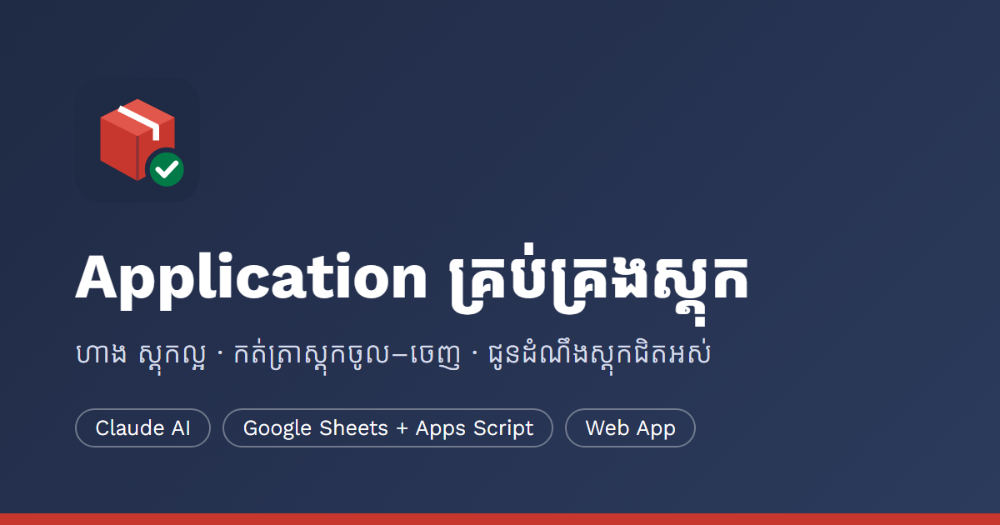

<p align="center">
  
</p>

<p align="center">
  <a href="https://stock-inventory-part3-website.vercel.app/"></a>
  
  
  
  
</p>

# Application គ្រប់គ្រងស្តុក (Stock & Inventory) — សម្រាប់ហាង / ឃ្លាំង

គម្រោងមាន ៣ ផ្នែក ដែលប្រើប្រធានបទតែមួយ៖ **ការគ្រប់គ្រងស្តុកចូល–ចេញ របស់ «ហាង ស្តុកល្អ»**។
បុគ្គលិកកត់ស្តុកពីទូរស័ព្ទ → Google Sheet គណនាសមតុល្យ → Email ជូនដំណឹងពេលទំនិញជិតអស់ → Claude AI សរសេររបាយការណ៍។

| | |
|---|---|
| 🌐 Live URL | https://stock-inventory-part3-website.vercel.app/ |
| 🗂️ Portfolio | https://stock-inventory-part3-website.vercel.app/portfolio.html |
| 🎬 Video Demo | _(ដាក់ Link YouTube នៅទីនេះ)_ |
| 💻 Git repo | https://github.com/pisakreatrey-rgb/stock-inventory |
| 🗄️ Backend | Google Sheet + Apps Script Web App (URL ក្នុង `part3-website/js/config.js`) |
| ✅ Checkpoint | [CHECKPOINTS.md](CHECKPOINTS.md) — កំណត់ត្រា ៤ សប្តាហ៍ |

```
├── part1-claude-ai/          ផ្នែកទី ១ — Claude Project + Prompt
│   ├── 00-project-instructions.md   Instructions សម្រាប់ Claude Project
│   ├── 01-knowledge-base.md         Knowledge Base ផ្ទាល់ខ្លួន
│   ├── 02-SOP-stock-in-out.md       SOP ស្តុកចូល/ចេញ
│   ├── 03-email-low-stock.md        Email ជូនដំណឹងស្តុកជិតអស់ + Email បញ្ជាទិញ
│   ├── 04-monthly-report.md         របាយការណ៍ស្តុកប្រចាំខែ
│   └── 05-prompts.md                Prompt Log ២២
├── part2-google-sheets/      ផ្នែកទី ២ — Google Sheet (Database) + Apps Script
│   ├── Code.gs                      API + PIN + Void + រាប់ស្តុក + Email + Trigger + Setup
│   └── sheet-structure.md           រចនាសម្ព័ន្ធ Sheet និង Formula
└── part3-website/            ផ្នែកទី ៣ — Web App (HTML/CSS/JS)
    ├── dashboard.html               ផ្ទាំងគ្រប់គ្រង៖ KPI · Chart ចូល/ចេញ · Top 5 · តម្លៃតាមប្រភេទ · ត្រូវបញ្ជាទិញ
    ├── index.html                   បញ្ជីទំនិញ + KPI + បន្ថែមទំនិញ (ម្ចាស់ហាង)
    ├── stock.html                   Form ស្តុកចូល/ចេញ + ប្រតិបត្តិការចុងក្រោយ + លុបចោល
    ├── balance.html                 តារាងសមតុល្យ + តម្រង + Stock Card
    ├── count.html                   រាប់ស្តុកជាក់ស្តែង → កែតម្រូវស្វ័យប្រវត្តិ
    ├── report.html                  របាយការណ៍តាមថ្ងៃ/ខែ/ឆ្នាំ · Export CSV · Print/PDF
    ├── portfolio.html               ទំព័រ Portfolio អំពីគម្រោង (KPI ពិត · Video · រូបថត)
    ├── assets/logo.svg · logo.png   Logo ហាង (ប្រើក្នុង Web App, Sheet, ឯកសារ)
    ├── assets/og-image.png          រូប Preview ពេល Share Link (1200×630)
    ├── css/style.css
    └── js/config.js · api.js · common.js · reports.js · movements-ui.js
```

## ត្រូវនឹងតម្រូវការអប្បបរមា
| ផ្នែក | តម្រូវការ | ក្នុងគម្រោងនេះ |
|---|---|---|
| ១ Claude AI | Project + Knowledge Base · ឯកសារ ≥ ២ · Prompt ≥ ១០ | Knowledge Base + SOP + Email ២ + Report · Prompt ២២ |
| ២ Sheets | Formula (XLOOKUP/SUMIFS/IF) + Pivot ឬ Chart ≥ ១ + Apps Script | Sheet Balance ប្រើ XLOOKUP/SUMIFS/IF · PivotTable + Column Chart · Apps Script Email/API |
| ៣ Website | ≥ ៣ ទំព័រ · Responsive · Live URL · Git repo | ៧ ទំព័រ (រួម Dashboard, របាយការណ៍, Portfolio) · Responsive (375px+) · Vercel Live URL · GitHub repo (ខាងលើ) |

## មុខងារ
| មុខងារ | ទំព័រ | ពន្យល់ |
|---|---|---|
| ផ្ទាំងគ្រប់គ្រង | `dashboard.html` | KPI ថ្ងៃនេះ/ខែនេះ · Chart ស្តុកចូល–ចេញ ៧/៣០/៩០ ថ្ងៃ · ទំនិញចេញច្រើន · តម្លៃតាមប្រភេទ · «នៅសល់ប្រហែល X ថ្ងៃ» |
| របាយការណ៍តាមកាលបរិច្ឆេទ | `report.html` | ថ្ងៃនេះ · ៧ ថ្ងៃ · ខែនេះ · ខែមុន · ឆ្នាំនេះ ឬជ្រើសថ្ងៃ · សង្ខេបតាមថ្ងៃ/ខែ/ឆ្នាំ · ដើមគ្រា→ចូល→ចេញ→ចុងគ្រា · មូលហេតុ · CSV · PDF |
| Stock Card | ចុចឈ្មោះទំនិញ | ប្រវត្តិប្រតិបត្តិការទាំងអស់ + សមតុល្យបន្តបន្ទាប់ + អ្នកកត់ |
| លុបចោល (Void) | Stock Card · ស្តុកចូល/ចេញ | ម្ចាស់ហាងប៉ុណ្ណោះ · ត្រូវមានមូលហេតុ · ជួរនៅតែមានក្នុង Sheet (Column `Void`) |
| រាប់ស្តុក | `count.html` | បញ្ចូលចំនួនរាប់បាន → បង្កើតប្រតិបត្តិការ «កែតម្រូវ» ដោយស្វ័យប្រវត្តិ · រក្សាទុកសេចក្តីព្រាងក្នុង Browser |
| ចូលគណនីដោយ PIN | គ្រប់ទំព័រកត់ត្រា | Sheet `Staff` · តួនាទី `owner` / `staff` · Column `By` កត់ឈ្មោះអ្នកកត់ |

Dashboard, របាយការណ៍ និង Stock Card គណនាក្នុង Browser ពីប្រតិបត្តិការទាំងអស់។ PIN, លុបចោល និងរាប់ស្តុក ត្រូវការ Code.gs Version 2។

---

## រូបថតអេក្រង់
> ដាក់រូបក្នុង `part3-website/assets/screenshots/` ហើយបន្ថែមក្នុង `SCREENSHOTS` នៃ `js/config.js` (វានឹងបង្ហាញក្នុងទំព័រ Portfolio ដោយស្វ័យប្រវត្តិ)។

| Claude Project | Sheet Balance + Chart | Web App (ទូរស័ព្ទ) |
|---|---|---|
| _(claude-project.png)_ | _(sheet-balance.png)_ | _(mobile.png)_ |

## ជំហានទី ១ — Claude Project
1. claude.ai → **Projects → Create project** → ឈ្មោះ «ជំនួយការគ្រប់គ្រងស្តុក»។
2. Paste អត្ថបទក្នុង `00-project-instructions.md` ទៅ **Project instructions**។
3. Upload `01`–`05` ទៅ **Project knowledge**។
4. សាកល្បង Prompt ពី `05-prompts.md`។

## ជំហានទី ២ — Google Sheet + Apps Script
1. បង្កើត Google Sheet ថ្មី → **Extensions → Apps Script**។
2. លុបកូដដើម → Paste `part2-google-sheets/Code.gs` → Save។
3. ជ្រើស Function **`setupSheets`** → **Run** → អនុញ្ញាត Permission។
   បង្កើត Sheet ទាំងអស់ + ទិន្នន័យគំរូ **២០ មុខ** (StockIn ២១ ជួរ · StockOut ២៦ ជួរ) + Formula + PivotTable + Chart + Logo។
   > Sheet ដែលមានទិន្នន័យ ១០ មុខរួចហើយ៖ Menu **📦 ស្តុក → បន្ថែមទិន្នន័យគំរូ (២០ មុខ)** (ឬ Run `seedExtraData`) ហើយ **ដាក់ Logo ក្នុង Sheet Balance**។
4. ក្នុង Sheet **Settings** ពិនិត្យ `AlertEmail` (Email ដែលទទួលការជូនដំណឹង)។
5. Run **`createTriggers`** ម្តង → Email ប្រចាំថ្ងៃ 8:00 + របាយការណ៍ថ្ងៃទី 1។
6. សាកល្បង៖ Run **`checkLowStock`** → ពិនិត្យ Inbox។
7. **Deploy → New deployment → Web app**
   - Execute as: **Me** · Who has access: **Anyone**
   - ចម្លង URL ដែលបញ្ចប់ដោយ `/exec`។

8. បើក Sheet **Staff** → មើល PIN ៦ ខ្ទង់ ដែលបង្កើតដោយចៃដន្យ → ប្តូរឈ្មោះ/PIN តាមបុគ្គលិកពិត។
   - `owner` = ម្ចាស់ហាង (លុបចោល · បន្ថែមទំនិញ) · `staff` = បុគ្គលិក (ស្តុកចូល/ចេញ · រាប់ស្តុក)

> ⚠️ ការកត់ត្រាត្រូវការ PIN តែការអាន (បញ្ជីទំនិញ · សមតុល្យ · របាយការណ៍) នៅតែបើកសម្រាប់អ្នកណាដែលមាន URL `/exec`។
> កុំចែករំលែក URL នេះជាសាធារណៈ ហើយកុំ Commit PIN ទៅ Git។
> រាល់ពេលកែ Code.gs ត្រូវ **Deploy → Manage deployments → Edit → New version**។

### Update ពី Version 1 → 2 (PIN · លុបចោល · រាប់ស្តុក)
1. Apps Script → លុបកូដចាស់ → Paste `Code.gs` ថ្មី → Save។
2. Run **`setupSheets`** ម្តងទៀត — ទិន្នន័យចាស់មិនបាត់ទេ។ វាបន្ថែម Column `By` · `Void`, Sheet `Staff`, Formula Balance ដែលមិនរាប់ជួរលុបចោល និង Pivot Filter។
3. **Deploy → Manage deployments → ✏️ Edit → Version: New version → Deploy** (URL `/exec` ដដែល)។
4. បើក Web App → Banner លែងបង្ហាញ «Backend ចាស់» → ចុច «ចូលគណនី» ហើយបញ្ចូល PIN។

## ជំហានទី ៣ — Web App
1. បើក `part3-website/js/config.js` → ដាក់ URL `/exec` ក្នុង `API_URL`។
2. សាកល្បងក្នុងម៉ាស៊ីន៖
   ```bash
   python -m http.server 5173 --directory part3-website
   ```
   បើក http://localhost:5173 — បើ `API_URL` ទទេ វាដំណើរការជា **Demo Mode** (ទិន្នន័យក្នុង Browser)។
3. **Git repo**
   ```bash
   git init
   ```
   ```bash
   git add . && git commit -m "Stock & Inventory app"
   ```
   បង្កើត Repo ក្នុង GitHub ហើយ `git remote add origin … && git push -u origin main`។
4. **Deploy (ជ្រើសមួយ)**
   - **Netlify**៖ Add new site → Import from GitHub → Base/Publish directory = `part3-website` → Deploy។
     (ឬអូសថត `part3-website` ទៅ app.netlify.com/drop)
   - **Vercel**៖ Add New Project → Import Repo → Root Directory = `part3-website` → Framework = Other → Deploy។
5. ដាក់ Live URL ក្នុង Sheet **Settings → WebAppUrl** ដើម្បីឲ្យ Email មាន Link ទៅតារាងសមតុល្យ។

## លំហូរទិន្នន័យ
```
Web App (Netlify/Vercel)
   │  GET  ?action=info|products|balance|movements
   │  POST {action: login|stockIn|stockOut|stockCount|void|addProduct, token}
   │        (text/plain → គ្មាន CORS preflight · token ពី login រក្សាក្នុង CacheService ៦ ម៉ោង)
   ▼
Apps Script Web App (doGet / doPost) ──► Google Sheet (Products · StockIn · StockOut · Balance · Staff)
   │
   ├─ ស្តុកចេញធ្លាក់ដល់ MinStock ──► Email ភ្លាមៗ
   ├─ Trigger រាល់ថ្ងៃ 8:00 ─────► checkLowStock() ──► Email
   └─ Trigger ថ្ងៃទី 1 ──────────► sendMonthlyReport() ──► Email
```

## ទំព័រ Portfolio
កំណត់ក្នុង `part3-website/js/config.js`៖
- `AUTHOR` — ឈ្មោះអ្នកធ្វើគម្រោង (បង្ហាញក្នុង Footer)
- `VIDEO_URL` — Link YouTube របស់ Video Demo (បង្ហាញជា Video ក្នុង Portfolio)
- `SCREENSHOTS` — បញ្ជីរូបថតអេក្រង់

ផ្នែកណាដែលទុកទទេ នឹងត្រូវលាក់ដោយស្វ័យប្រវត្តិ។
